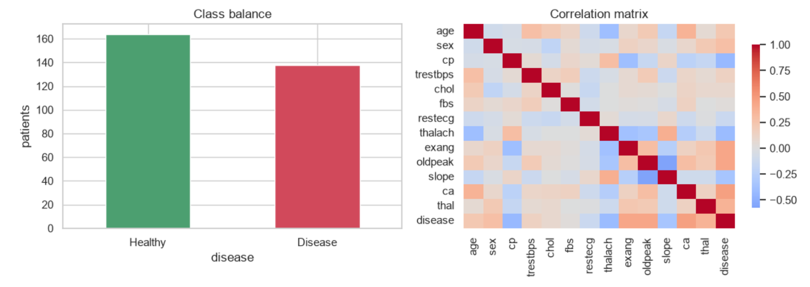
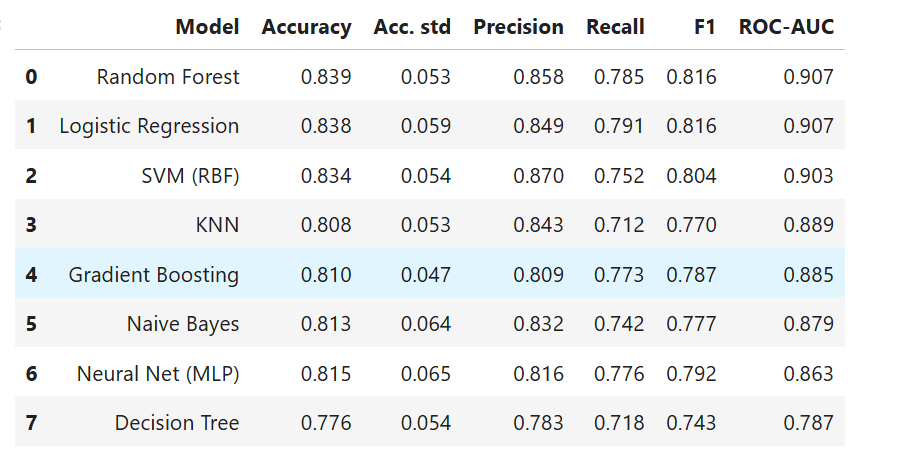
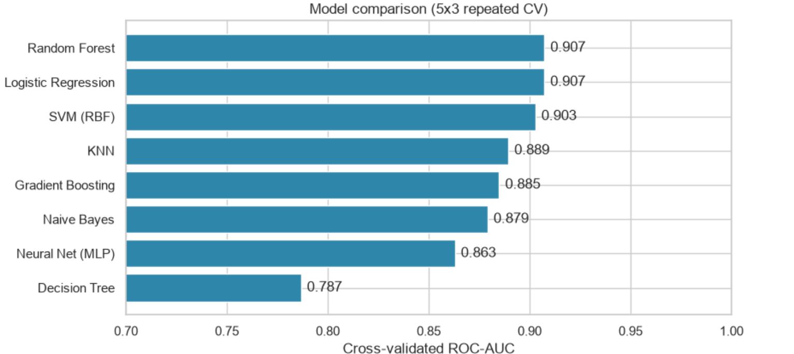
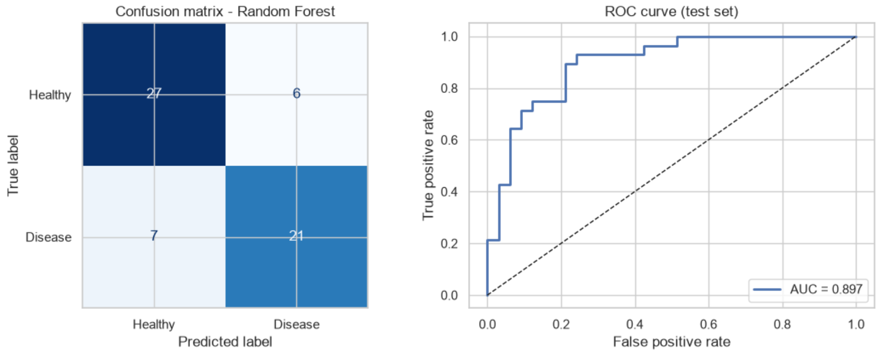
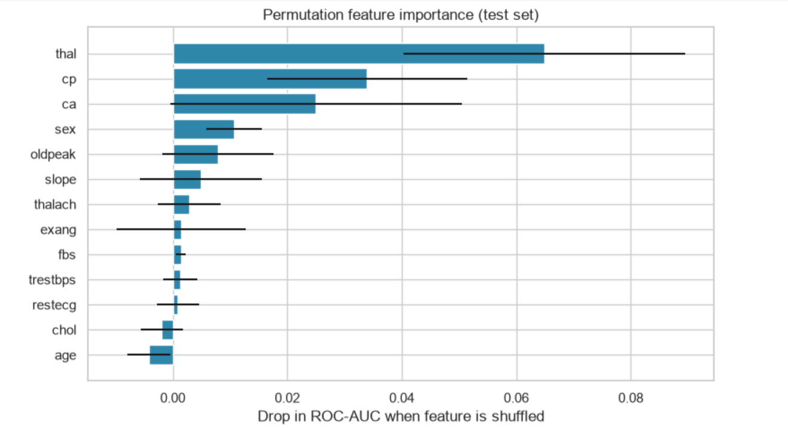

# ❤️ Heart Disease Prediction Using Machine Learning

A machine learning project that analyses patient health data to estimate heart disease risk using multiple classification algorithms.

## 📌 Project Overview

This project uses patient medical attributes to build and evaluate machine learning models for heart disease prediction. It compares eight classification algorithms, applies cross-validation and hyperparameter tuning, and evaluates the selected model on a held-out test set.

The project is intended for educational purposes and is not a medical diagnostic tool.

## ✨ Features

- Data cleaning and duplicate removal
- Exploratory Data Analysis (EDA)
- Feature preprocessing using a machine learning pipeline
- Comparison of eight classification algorithms
- Repeated stratified cross-validation
- Hyperparameter tuning
- Model evaluation using multiple performance metrics
- Permutation feature importance
- Saved model for future predictions
- Input validation in the prediction script

## 🛠️ Tech Stack

- **Language:** Python
- **Data Processing:** Pandas, NumPy
- **Machine Learning:** Scikit-learn
- **Visualization:** Matplotlib, Seaborn
- **Model Persistence:** Joblib
- **Environment:** Jupyter Notebook

## 🤖 Machine Learning Algorithms

The project compares the following algorithms:

1. Logistic Regression
2. K-Nearest Neighbors (KNN)
3. Support Vector Machine (SVM)
4. Decision Tree
5. Random Forest
6. Gradient Boosting
7. Naive Bayes
8. Neural Network (MLP)

## 📊 Results

The cross-validation comparison produced the following ROC-AUC scores:

| Algorithm | Accuracy | ROC-AUC |
|---|---:|---:|
| Random Forest | 83.9% | 0.907 |
| Logistic Regression | 83.8% | 0.907 |
| SVM (RBF) | 83.4% | 0.903 |
| KNN | 80.8% | 0.889 |
| Gradient Boosting | 81.0% | 0.885 |
| Naive Bayes | 81.3% | 0.879 |
| Neural Network (MLP) | 81.5% | 0.863 |
| Decision Tree | 77.6% | 0.787 |

These are the notebook's reported cross-validation results. The final tuned model's test-set results may differ.

## 📷 Project Screenshots

### 1. Exploratory Data Analysis

Shows class distribution and correlations between patient features.



### 2. Model Comparison Table

Compares all eight algorithms using accuracy, precision, recall, F1-score and ROC-AUC.



### 3. ROC-AUC Comparison

Visual comparison of cross-validated ROC-AUC scores.



### 4. Final Model Evaluation

Confusion matrix and ROC curve for the held-out test set.



### 5. Feature Importance

Permutation importance shows how shuffling individual features affects the model's ROC-AUC.



## 📁 Project Structure

```text
Heart-Disease-Prediction/
├── HeartDiseasePrediction_Advanced.ipynb
├── predict.py
├── heart.csv
├── heart_model.joblib
├── requirements.txt
├── README.md
├── .gitignore
└── figures/
    ├── 01-eda.png
    ├── 02-model-comparison-table.png
    ├── 03-model-comparison-roc-auc.png
    ├── 04-model-evaluation.png
    └── 05-feature-importance.png
```

## ⚙️ Installation and Setup

### 1. Clone the repository

```bash
git clone https://github.com/ayushi0804/heart-disease-prediction-ml.git
```

Replace the repository URL with your own GitHub repository URL.

### 2. Create a virtual environment

```bash
python -m venv .venv
```

Activate it on Windows:

```bash
.venv\Scripts\activate
```

### 3. Install dependencies

```bash
pip install -r requirements.txt
```

### 4. Run the notebook

```bash
jupyter notebook
```

Open `HeartDiseasePrediction_Advanced.ipynb` and run the cells from top to bottom to reproduce the analysis and training workflow.

### 5. Run the prediction script

```bash
python predict.py
```

Ensure that the saved model file is available in the expected location.

## 📈 Evaluation Metrics

The project uses:

- **Accuracy:** Overall proportion of correct predictions
- **Precision:** Proportion of positive predictions that are correct
- **Recall:** Proportion of actual positive cases identified
- **F1-score:** Harmonic mean of precision and recall
- **ROC-AUC:** Ability to distinguish between the two classes
- **Confusion Matrix:** Breakdown of correct and incorrect predictions

## ⚠️ Limitations

- The dataset contains a limited number of unique patient records.
- Performance on other populations may differ.
- The model is not clinically validated.
- Predictions should not be used for medical diagnosis or treatment decisions.

## 🚀 Future Improvements

- External validation using additional datasets
- Explainable AI with SHAP
- Probability calibration
- Interactive web interface using Streamlit

## 👩‍💻 Author

**Ayushi Singh**

Computer Science Engineering Student 

---

**Disclaimer:** This project is for learning and experimentation only. It is not intended to replace professional medical advice or diagnosis.
